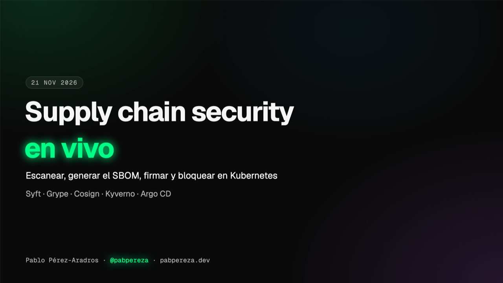

# supply-chain-demo

Demo de la charla **"Supply chain security en vivo: escanear, generar el SBOM, firmar y bloquear en Kubernetes"** (Cloud Native Guayaquil & Quito).

[](slides/supply-chain-security-en-vivo.pdf)

- 📑 **Slides de la charla**: [supply-chain-security-en-vivo.pdf](slides/supply-chain-security-en-vivo.pdf)
- 🧪 **La práctica, comando a comando**: [PRACTICA.md](PRACTICA.md)

Un clúster local (kind) con Argo CD sincronizando `deploy/`. Paso a paso se endurece el camino de la imagen hasta producción:

1. **Guardarraíles** con una `ValidatingPolicy` de Kyverno en CEL: sin `latest`, sin `privileged`, `runAsNonRoot`, límites y solo imágenes de `docker.io/pabpereza`. Se escribe para Pods y Kyverno la extiende sola a Deployments, Jobs...
2. **SBOM con Syft y escaneo con Grype** en el pipeline: Syft hace el inventario y Grype lo revisa; si hay CVEs críticas con parche no se publica
3. **El ataque**: con un token del registry filtrado se sube una imagen que cumple todas las reglas... y pasa
4. **Firma con Cosign** + `ImageValidatingPolicy`: solo se admite lo firmado por el pipeline y siempre por digest, que el pipeline fija en Git
5. **SBOM firmado**: el pipeline adjunta el SBOM de Syft (CycloneDX) a la imagen con `cosign attest`. Kyverno rechaza las imágenes que no lo traen. Cuando salga una CVE nueva, se recupera del registry y se vuelve a escanear sin reconstruir:

```bash
cosign verify-attestation --key cosign.pub --type cyclonedx \
  --insecure-ignore-tlog --insecure-ignore-sct <imagen@sha256:...> \
  | jq -r .payload | base64 -d | jq .predicate > sbom.cdx.json
grype sbom:sbom.cdx.json
```

## Estructura

| Ruta | Qué es |
|------|--------|
| `app/` | La aplicación legítima (nginx sin privilegios) |
| `attacker/` | La imagen del atacante |
| `deploy/` | Lo que despliega Argo CD |
| `policies/kyverno/guardarrailes.yaml` | Reglas básicas del Pod (CEL) |
| `policies/kyverno/require-signed.yaml` | Verificación de la firma y del digest |
| `policies/kyverno/require-sbom.yaml` | Exige el SBOM firmado por el pipeline |
| `argocd/` | La `Application` de Argo CD |
| `PRACTICA.md` | La demo comando a comando, desde montar el laboratorio |
| `slides/` | Las slides de la charla en PDF y su portada |
| `ci.sh` | El pipeline: build, Syft, Grype, push, firma, SBOM firmado y digest en `deploy/`. `./ci.sh` lo ejecuta entero y `./ci.sh <paso>` uno solo |
| `.github/workflows/ci.yml` | El mismo pipeline en GitHub Actions: llama a `./ci.sh <paso>` en cada step |
| `attack.sh` | Sube la imagen del atacante con el tag que quieras |
| `signing-config.json` | Configuración de firma de Cosign sin Rekor ni CA: la usan `ci.sh` y la práctica |
| `cosign.pub` | Clave pública del pipeline (la privada nunca está en el repo) |

## GitHub Actions

El workflow `ci` corre con cada push a `main` que toque `app/` o a mano desde la pestaña Actions (con casillas para `SCAN`, `SIGN` y `SBOM`). Construye en un runner arm64, como el clúster de la demo, y termina con un commit de `deploy/` que Argo CD sincroniza.

No tiene lógica propia: cada step es un `./ci.sh <paso>`, así que lo que funciona en local funciona en Actions y al revés. El primer step falla si los pasos del workflow no coinciden con los de `ci.sh` (ver `AGENTS.md`).

Secretos del repositorio:

```bash
gh secret set DOCKERHUB_USERNAME --body pabpereza
gh secret set DOCKERHUB_TOKEN                     # token de acceso de Docker Hub con permiso de escritura
gh secret set COSIGN_PRIVATE_KEY < ~/.config/supply-chain-demo/cosign.key
```

## Versiones probadas

Kubernetes 1.37 (kind 0.33), Kyverno 1.20, Argo CD 3.x, Cosign 3.1.4, Syft 1.57.2, Grype 0.122.0.
